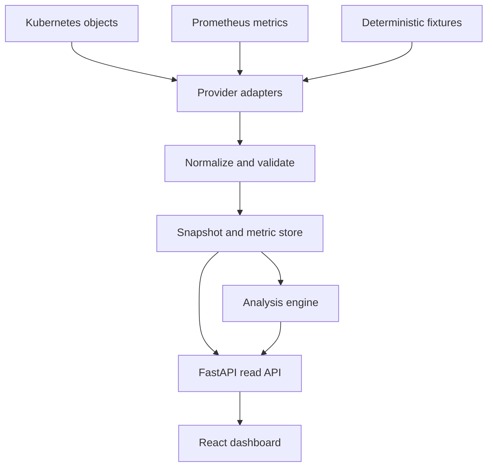
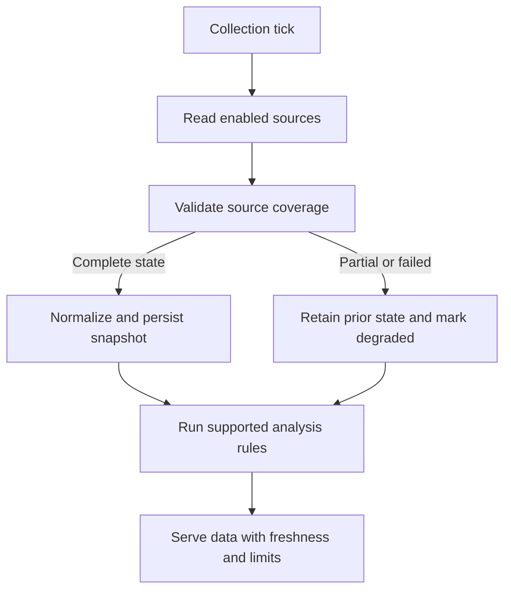

# Kubernetes GPU Observability & Workload Inspector

**Technical specification · v0.1 · 15 October 2026 · For Khalil Ben Maaoui’s review**

Status: proposed design, not an implemented or validated product. The four-hour implementation budget is a target contingent on a working container environment. This document defines the complete intended flow and deliberately separates the first build from subsequent integrations.

## 1. Decision summary

Build a read-only operations dashboard that correlates cluster configuration, workloads, resource allocation, telemetry and collected history. Its central workflow is:

**Select a workload → inspect its requests and placement → see relevant nodes and measurements → inspect an explanation with evidence and limitations.**

Use FastAPI/Pydantic, SQLite, and React/TypeScript. A background collector normalizes input through replaceable provider interfaces; analysis functions produce structured findings; the frontend presents those findings without calculating its own scheduling logic.

The first version has two selectable datasets:

- **Local Kubernetes:** real Nodes, Pods, Jobs and Events, plus optional CPU/memory metrics. Deploy the application itself here to gain hands-on deployment and troubleshooting experience.
- **GPU demo:** a self-contained synthetic cluster, explicit workload allocations, GPU time series, topology labels and optional KAI-style queue metrics. All GPU findings retain a visible synthetic-data badge.

Do not attach fake GPU capacity or measurements to live cluster objects by default. Both datasets use the same internal contracts and analysis pipeline, but are isolated by dataset ID. This makes the demonstration reproducible and keeps its claims clear.

### Outcomes

1. Show the difference between advertised capacity, requested allocation, and measured usage.
2. Explain a constrained subset of pending-workload placement problems.
3. Preserve snapshots and events so users can inspect what changed.
4. Visualize node/workload relationships and available topology metadata.
5. Make each insight traceable to source records, timestamps and assumptions.

This is operational analysis tooling, not a scheduler, GPU simulator, training framework, or automated remediation system. It will not evict, resize, submit, migrate or modify workloads.

## 2. Evidence that shapes the design

The following are source facts; the architecture, thresholds and product choices elsewhere are proposals.

| Finding | Design consequence | Source |
|---|---|---|
| Kubernetes exposes object state and GPU resource requests in the conventional device-plugin model | Collect state through the API; treat GPU resource units separately from hardware utilization | [S1] |
| The resource Metrics API supplies CPU/memory measurements | Do not expect GPU utilization from Metrics Server | [S2] |
| DCGM Exporter exposes NVIDIA GPU measurements in Prometheus format; field availability varies | Make hardware telemetry optional and version-aware | [S3, S4] |
| KAI exposes queue allocation/fair-share and scheduler timing metrics | Support an optional KAI metrics adapter, not a requirement to run the app | [S5] |
| Kubernetes lists and watches have resource-version semantics and watch expiration handling | Poll initially; add resilient list/watch later | [S6] |
| API-server Event retention defaults to one hour, and can be configured | Persist observed events; do not promise complete historical recovery | [S7] |
| Prometheus supports instant and range queries | Read existing historical telemetry rather than building a general time-series database | [S8] |
| A node’s zone label may not exist | Group missing topology under “Unknown,” not an invented rack or network | [S9] |
| Device attribution can require kubelet PodResources information or exporter-provided mappings | Pod-to-node placement is not sufficient to identify a physical GPU UUID | [S10] |

KAI’s main-branch metrics documentation was inspected at file blob SHA `ca4e43fdbee08a71d7ac820357b33b3e21785e47`. This is a documentation snapshot, not a supported release guarantee. Pin concrete Kubernetes/client, KAI and exporter versions when implementing each live adapter; do not target an unspecified “latest” contract.

## 3. Scope and priorities

| Capability | Four-hour MVP | Next iteration |
|---|---|---|
| FastAPI + frontend | One overview with drill-down panel | Dedicated workload/history/topology routes |
| GPU input | Deterministic, source-shaped fixtures | Live Kubernetes GPU state and DCGM via Prometheus |
| Kubernetes input | Poll Nodes, Pods, Jobs, core Events | Watch/relist, broader owner resolution |
| History | Timestamped snapshots and bounded event retention | Long-range Prometheus queries and change indexing |
| Topology | Node grouping and workload-placement edges | Explicit fabric inventory, links and validated hardware mappings |
| Insights | Count fragmentation, constraint mismatch, sustained low GPU activity | KAI fair-share context, richer constraints and gang placement |
| Deployment | Single application replica on kind | Production auth, multi-user isolation, separate collector |
| Testing | Fixture invariants and one live smoke test | Adapter contracts, replay tests, larger datasets |

**Out of scope for the MVP:** real inference/training execution, GPU performance improvement claims, MIG, time-slicing, fractional allocation, DRA allocation analysis, NVLink path inference, network contention simulation, cost optimization, alerts to external channels, user accounts, public hosting, multi-cluster aggregation, Slinky installation, custom Kubernetes scheduler plugins.

Do not integrate the existing scheduler simulator today. Reuse the architectural understanding, not its database or scheduler logic. The tool observes actual/fixture placement; it does not replace it with a simulated scheduler’s answer.

## 4. System architecture



Provider modules are application adapters, not Kubernetes device plugins or scheduler extensions. Keep one backend process and one collector loop in the MVP. Serve the compiled frontend through the backend so local and in-cluster deployment use one image, one origin and one Service.

### Repository layout

| Path | Responsibility |
|---|---|
| `backend/app/providers/` | Fixture and Kubernetes clients; future Prometheus adapter |
| `backend/app/models/` | Pydantic normalized contracts and validation |
| `backend/app/analysis/` | Pure resource accounting and diagnostic rules |
| `backend/app/storage/` | SQLite snapshots, samples and event observations |
| `backend/app/api/` | Dataset, snapshot, history and health endpoints |
| `frontend/src/` | Typed API client, overview, node cards and detail panel |
| `fixtures/` | Versioned scenarios, source examples and expected findings |
| `deploy/` | Namespace, ServiceAccount, RBAC, Deployment and Service |
| `tests/` | Scenario and adapter contract tests |
| `docs/` | Runbook, results, source mapping and limitations |

## 5. Source contracts and collection

### 5.1 Kubernetes state provider

Use the maintained Python Kubernetes client and explicit kubeconfig context for external development, or in-cluster credentials for deployment. Display the selected context/cluster identity before running a live demonstration. Never silently use whichever context happens to be current.

Collect the following allowlisted fields rather than storing complete object bodies:

| Object | Fields needed | Purpose |
|---|---|---|
| Node | UID/name, capacity, allocatable, Ready condition, unschedulable flag, labels, taints | Inventory and eligibility |
| Pod | UID/namespace/name, owner references, schedulerName, nodeName, timestamps, conditions, phase, requests/limits, nodeSelector, relevant placement constraints | Allocation and lifecycle |
| Job | UID, owner references, completion/parallelism settings, status and timestamps | Group batch pods |
| Event | UID, involved-object UID, reason, message, type, timestamps, count | Scheduler-reported evidence and timeline |

Use `/api/v1/nodes`, `/api/v1/pods`, `/apis/batch/v1/jobs`, and `/api/v1/events` in the initial adapter. Core Events keep the first build simple; support the newer events API as an adapter option later, without double-counting both representations.

Workload grouping: Job-owned Pods group by Job UID. Other Pods remain individual workloads, with available owner metadata displayed. Do not call a Kubernetes Job, a Deployment and a KAI PodGroup interchangeable. Full recursive controller ownership and KAI group membership are later extensions.

The collector must see all Pods relevant to a node before asserting that node’s remaining resource capacity. Namespace filtering is a UI operation, not a reason to subtract only the visible namespace’s requests. With incomplete permissions, report partial coverage and suppress definitive capacity explanations.

### 5.2 CPU/memory provider

Discover the installed Metrics API version; use it only if available. Record source timestamps and measurement windows. Convert CPU quantities to cores and memory quantities to bytes using a tested quantity parser. CPU/memory telemetry failure must not prevent state collection. [S2]

In the first build, live CPU/memory charts are optional; object collection and an honest “metrics unavailable” state are sufficient. Avoid spending the session debugging Metrics Server certificates or installing a monitoring stack.

### 5.3 GPU metrics provider

The intended live path is DCGM Exporter → existing Prometheus → backend. Initial fixtures reproduce a selected contract: GPU UUID, node association, metric name, timestamp, value, unit and optional workload mapping.

Use utilization (`DCGM_FI_DEV_GPU_UTIL`) and framebuffer memory (`DCGM_FI_DEV_FB_USED`, `DCGM_FI_DEV_FB_FREE`) first. Normalize units through an explicit mapping verified against the installed exporter; do not guess from the numeric range. Treat unavailable/sentinel/non-finite measurements as missing with a reason. Temperature and power are later panels. [S3, S4]

Device identity and observation identity differ: GPU UUID identifies hardware; Pod UID identifies a workload instance; a node name identifies placement. Join GPU-to-workload only with an explicit valid mapping. If the exporter supplies namespace/pod/container names but not UID, resolve against the inventory at the sample time and reject ambiguous or reused names. If attribution is absent, show node/device telemetry only. Do not split a GPU’s activity evenly across its workloads.

### 5.4 KAI provider

Start with fixtures for `queue_allocated_gpus`, `queue_fair_share_gpu`, and `task_scheduling_latency_milliseconds`. Allocation and fair share are counts; scheduling latency is a histogram measuring creation-to-bind-attempt delay, not application startup or execution time. `queue_gpu_usage` has configuration-dependent semantics and is excluded initially. Scrape labels such as `pod` can identify the exporting scheduler component. [S5]

Live Queue/PodGroup objects require API discovery and version-specific adapters. A KAI queue panel is optional; missing CRDs or metrics mean “not connected,” not zero usage. Store the scheduler/shard scope when available. A histogram percentile must aggregate compatible buckets; never average per-instance percentiles. Default KAI live analysis remains deferred.

### 5.5 Prometheus access

The future adapter uses fixed, server-owned query templates through `/api/v1/query` and `/api/v1/query_range`, with bounded time ranges and steps. Preserve query warnings, timestamps and source identity. Do not expose arbitrary PromQL or arbitrary target URLs through the frontend. [S8]

Prometheus is optional in the four-hour build. Fixture samples use our normalized metric contract and retain a small source-shaped example for adapter tests. A static sample is not advertised as evidence that a live exporter integration works.

### 5.6 Topology provider

Define three edge types and never conflate them:

- `contains`: cluster/zone/rack/node containment based on known labels or explicit inventory.
- `placed_on`: Pod → Node assignment.
- `physical_link`: supplied fabric connection with source, link type and optional capacity/latency.

The MVP displays the first two. Zone labels are optional; rack labels require a configurable, documented key. An unknown label goes into “Unknown.” Physical leaf–spine or NVLink diagrams require imported inventory or an explicitly synthetic fixture. Neither node proximity on screen nor shared zone implies a physical network link. [S9]

## 6. Normalized data model

Use a schema version and stable internal identifiers. All timestamps are UTC RFC3339. Store source observation time separately from ingestion time.

| Entity | Essential fields |
|---|---|
| `Dataset` | id, name, mode (`live`/`fixture`), cluster_id, capabilities, scenario_id |
| `Snapshot` | id, dataset_id, collection_start/end, per-source status, completeness, schema_version |
| `NodeState` | uid, name, readiness, resource capacity/allocatable, placement labels, taints, accounting_status |
| `Workload` | id, kind, owner_uid, namespace/name, pod_uids, aggregate display status |
| `PodState` | uid, node_uid, phase, scheduling condition, effective requests, constraint support status |
| `GPUDevice` | id/UUID, node_uid, model, allocation_mode, provenance |
| `DeviceAssignment` | device_id, pod_uid, container_name, valid_from/to, mapping_source |
| `MetricSample` | dataset, source, entity_id, metric, timestamp, value, unit, quality |
| `EventObservation` | event_uid, object_uid, source_count, first/last event time, observed_at, reason/message |
| `TopologyEdge` | source_id, target_id, edge_type, provenance, optional attributes |
| `Insight` | id, rule/version, snapshot_id, subject_id, kind, evidence, limitations, status |

Every source status contains `last_success_at`, `last_attempt_at`, `error_code`, `coverage`, and `stale_after_seconds`. Never encode “no permission,” “no device,” or “no sample” as numerical zero.

**Units:** CPU cores (decimal), memory bytes (integer), whole GPU device units (integer), utilization percent after explicit conversion, durations milliseconds. Unknown GPU resource semantics remain opaque units and are excluded from whole-device formulas.

### Provider interface

```python
class StateProvider(Protocol):
    async def collect(self) -> StateBatch: ...

class MetricProvider(Protocol):
    async def query(self, request: MetricQuery) -> MetricBatch: ...

class TopologyProvider(Protocol):
    async def collect(self) -> TopologyBatch: ...
```

Each batch includes dataset ID, source version, observation bounds, completeness and warnings. Fixture and live implementations return the same types. Analysis functions receive normalized inputs and an explicit clock, making replay and tests deterministic.

## 7. Collection, history and failure flow

### Proposed MVP defaults

State poll: 15 seconds. Frontend refresh: 5 seconds from stored state. Metric cadence: 15 seconds when supported. Stale threshold: 45 seconds. Source request timeout: 5 seconds. No overlapping collection cycles. One retry on the next cycle rather than holding the UI request open. All values are configurable proposal defaults, not upstream requirements.



State lists are not an atomic transaction across resource kinds. Preserve per-kind observation times; if node/Pod collection skew exceeds 30 seconds, suppress placement findings. If any list page fails, do not treat unseen objects as deleted. Mark missing objects only after a successful complete list. Negative inferred free capacity is an accounting conflict to display, not a value to silently clamp away.

Persist each completed snapshot and its insights atomically. Metrics and events may arrive separately, but include timestamps and are bounded to the selected snapshot for analysis. The UI requests details by snapshot ID so it does not combine an old summary with new node availability.

### SQLite design

Use five small tables: `datasets`, `snapshots` (normalized JSON), `samples`, `event_observations`, `insights` (JSON plus indexed rule/subject fields). Keep relational identity/time columns outside JSON. Use WAL mode and a single writer. Index dataset/time, metric/entity/time and object/event identity.

Proposed retention: 24 hours locally, plus a 100 MB soft database target. A periodic cleanup removes oldest data beyond retention; if the target remains exceeded, shorten retained history and expose the actual earliest available timestamp. SQLite file compaction is maintenance, not part of every polling cycle. This is bounded demo storage, not a scalable monitoring database.

Deduplicate metric samples by dataset/source/metric/label identity/timestamp. Event counts are cumulative observations: an update from count 3 to 5 adds two observed occurrences, not five. Decreases or recreation create a new observation segment. Event collection cannot guarantee an audit trail. [S7]

### History behavior

- Live history begins when collection starts; show that timestamp prominently.
- Synthetic history has a fixed scenario clock and explicit “scenario time” label.
- Historical views use stored state at or before the selected time and samples no later than that time; never join historical usage against today’s placement.
- Mark gaps; do not interpolate through collection outages or extend the last observation indefinitely.
- Store lifecycle transitions as “observed between snapshots” unless an authoritative event/condition timestamp establishes the time. Polling can miss short-lived objects.

Future list/watch support must retain resourceVersion, reconnect, handle expiration by relisting, and tolerate bookmarks without assuming a fixed bookmark interval. It is a separate implementation step. [S6]

## 8. Resource accounting and diagnostic rules

### 8.1 Accounting boundary

Whole-device, exclusive GPU allocation is the only supported GPU mode initially. Capacity is the advertised resource quantity, and requested allocation is inferred from bound, nonterminal Pods. A Pending Pod with `nodeName` can already hold a placement; an unbound Pending Pod is demand, not allocated capacity. Include terminating nonterminal Pods until the conservative accounting no longer counts them.

For ordinary application containers, aggregate requests per resource. GPU limits can supply effective requests under Kubernetes GPU resource rules. CPU/memory quantities use their own parsing rules. [S1]

Ordinary init-container requests require a maximum-versus-sum calculation plus Pod overhead; restartable init containers, Pod-level requests, resize state and other newer mechanisms need additional handling. [S11] The MVP supports plain Pods without those features. It detects unsupported resource-bearing forms, displays raw requests, and marks affected node capacity analysis incomplete rather than making an incorrect calculation. Do not exclude unsupported Pods from allocation totals and then report the resulting capacity as free.

The tool cannot see all scheduler-internal assumptions or reservations. Therefore live availability is an observed estimate, not a guarantee of admission. Device UUID assignments are a different fact from requested counts. [S10]

### 8.2 Supported eligibility filter

For the MVP, inspect readiness, unschedulable state, exact `nodeSelector` matches, resource type, and simple taint/toleration matching. The test fixtures exercise a deliberately controlled subset. Required node affinity, inter-Pod affinity, topology-spread constraints, storage binding, gang scheduling, DRA and scheduler-specific predicates are detected and labeled unsupported. Do not output “this will schedule” when they are present.

### 8.3 Rule: placement fragmentation

For a single Pod requiring `g` whole GPUs on one node, first construct nodes eligible under supported non-capacity constraints. On each eligible node `i`:

`F_i = allocatable_gpu_i - requested_gpu_i`

Require complete, fresh, nonnegative accounting. Let `T = sum(F_i)` and `L = max(F_i)`, with `L = 0` if no eligible nodes.

| Condition | Finding |
|---|---|
| No eligible nodes | Eligibility/constraint limitation |
| `T < g` | Insufficient aggregate free GPUs within eligible nodes |
| `T >= g` and `L < g` | Per-node GPU-count fragmentation under the modeled constraints |
| `L >= g` | GPU count permits at least one candidate; other constraints may still block placement |

CPU and host memory checks can eliminate candidate nodes separately; label their blockers separately. Do not call a CPU shortage GPU fragmentation. The request is per Pod, not the total GPU count of an arbitrary multi-Pod job. A group of four one-GPU Pods is not equivalent to a single four-GPU Pod.

The main display is the explanation plus the per-node free-capacity distribution. Do not introduce a global “fragmentation percentage” without a workload distribution and definition.

### 8.4 Rule: allocation with sustained low activity

For a GPU with an explicit exclusive assignment, consider a five-minute window with at least 80% of expected samples and an assignment stable throughout that window. Proposal threshold: mean utilization below 10%. Require fresh data and valid unit normalization. Thresholds are visible and configurable.

Output: “Allocated GPU shows low observed activity over this window.” Include sample coverage, window, assigned workload and measured mean. This is an investigation lead, not proof of waste: loading, synchronization, data input and workload phase can explain it. No automatic release or recommendation to reduce GPUs.

If only device-level attribution is reliable, report a device-level insight. If assignment changes mid-window, split the window or return insufficient evidence. High utilization is not proof of useful application throughput; that needs application measurements.

### 8.5 Rule: constraint mismatch

Compare exact required node labels to inventory. Show why each node is excluded and which resource units lie outside the eligible set. Example: capacity exists on model B, but the pending Pod explicitly selects model A. Model labels need explicit configuration; do not infer capability solely from a name string.

Return “no match under checked labels,” not an all-encompassing root cause. Display scheduler-reported events beside our derived interpretation as separate evidence types.

### 8.6 KAI context, later

Show allocated versus fair-share GPU counts for a queue when scopes align. A difference alone is not unfairness: pending demand, hierarchy and scheduling policy matter. Histogram timing can distinguish long scheduling delays from other stages, but not automatically identify their cause. [S5]

### Insight example

```json
{
  "rule": "single_pod_gpu_fragmentation",
  "rule_version": "1",
  "dataset_id": "gpu-demo",
  "snapshot_id": "fragmented-003",
  "subject_id": "pod:pending-four",
  "status": "supported",
  "provenance": "fixture",
  "summary": "4 GPUs free overall; largest eligible node has 2; pod requests 4 on one node.",
  "evidence": {"request": 4, "total_free": 4, "largest_free": 2},
  "limitations": ["Whole GPUs", "Single pod", "Only declared supported constraints evaluated"]
}
```

## 9. Backend API and user flows

All data routes are read-only. Prefix with `/api/v1`. Use a common envelope: `data`, `dataset_id`, `snapshot_id`, `observed_at`, `source_status`, `warnings`. Missing measurements are null with a reason. Validate ranges and cap responses.

| Endpoint | Purpose |
|---|---|
| `GET /datasets` | Available live/demo datasets and capabilities |
| `GET /datasets/{id}/snapshot?at=...&scenario=...` | Overview, nodes, workload summaries, topology and insights from one snapshot |
| `GET /datasets/{id}/workloads/{uid}?snapshot_id=...` | Pod details, placement, requests, events, insight evidence |
| `GET /datasets/{id}/history?metric=...&entity=...&from=...&to=...&step=...` | Bounded series, gaps and coverage |
| `GET /datasets/{id}/events?object_uid=...&cursor=...` | Event observations, paginated |
| `GET /healthz` | Process liveness |
| `GET /readyz` | Storage and API readiness; degraded source status is returned separately |

For small MVP datasets the snapshot response can include all objects, capped at 50 nodes and 500 Pods. Exceeding the cap makes coverage explicit and suppresses complete-cluster analysis; do not truncate silently. Later introduce backend pagination and filtered graph endpoints. History response budget: at most 500 points per series and 20 series. Pagination cursors preserve dataset and snapshot identity.

Selecting a scenario is a GET parameter for fixture datasets; it does not change global backend state. Live datasets reject scenario parameters. Two browser tabs can inspect different fixtures safely.

### Flow A: open the dashboard

Fetch datasets → select a dataset → load snapshot → show source badges and collection status → populate cards/table → poll stored state. A failed refresh preserves the last successful view with its age; no chart resets to zero.

### Flow B: investigate a pending workload

Click pending row → load snapshot-pinned details → show requested resources and scheduler-reported events → highlight eligible/excluded nodes → show our supported-rule findings → expand evidence/limitations. If the Pod is already assigned but Pending, show startup/runtime status rather than assuming a scheduling failure.

### Flow C: investigate low GPU activity

Click an insight → focus its device and assigned workload → display allocation period and utilization samples on the same time axis → show coverage and source → inspect available events. Do not infer a precise application bottleneck from utilization alone.

### Flow D: inspect history

Choose a time window or demo frame → stop auto-follow → load stored snapshot and bounded samples → show an explicit historical banner → compare allocation/state changes → “Return to live” restores auto-follow. The first build may use discrete scenario frames rather than an animated player.

### Flow E: degraded source

Metrics unavailable while API works → retain inventory, show usage as unavailable, disable telemetry-dependent findings. Kubernetes source stale while metrics continue → show device measurements with stale-placement warning, disable allocation/workload correlation. Entire source disconnected → retain last snapshot and freshness status; no silent fallback to fixtures.

## 10. Frontend specification

Visual direction: restrained technical dashboard, neutral background, clear typography and spacing, blue for allocations, a separate hue for measured activity, amber for investigation leads and red only for actual failures. Use labels/icons in addition to color. Prefer a small number of legible charts over a dense wall of gauges.

### Main screen, in order

1. Header: dataset, mode, last observation time, source health and refresh state.
2. Summary: allocatable GPU units, requested GPU allocation, unallocated estimate, pending unbound Pods. In live CPU-only mode show CPU equivalents and GPU “not advertised.”
3. Two-column body: node/resource view on the left; workload table and insights on the right.
4. Selected workload/node detail panel with evidence and short history.

### Node/resource view

Use a CSS/SVG grid grouped by known zone/rack labels. Each node has capacity/allocation bars and a clearly separate usage indicator. In GPU fixtures, show one small cell per device with allocation and selection state. Never add measured-usage percentages and allocation percentages together. The initial topology is a resource/placement view, not a physical fabric map.

### Workload table

Columns: name/kind, namespace, phase/scheduling state, GPU request, node, age, insight count. Filters: status, namespace, node. Sorting: pending age, request count, name. Job rows expand to Pods; analysis operates at the Pod level in this version. Namespace filters must not change cluster-wide free-capacity arithmetic.

### Detail panel

Tabs or compact sections: requirements, placement eligibility, telemetry, events, evidence. Show “Observed,” “Scheduler reported,” and “Derived” labels. Every number has a unit; every chart has time range and coverage. Empty states distinguish no workload, no device, insufficient permissions, unsupported mode and stale source.

Keyboard-accessible node buttons and rows; a table alternative to the topology graphic; visible focus indicators. A small screen collapses columns into a vertical layout. No 3D rendering, graph physics or decorative animation in the MVP.

## 11. Reproducible scenarios

Each fixture contains source-shaped Node/Pod/Job/Event examples, normalized telemetry samples, a manifest of source schema assumptions, and expected findings. Fixed timestamps and identifiers; no random values unless seeded and recorded. Fixture GPU units never require actual device plugins.

| Scenario | Configuration | Expected result |
|---|---|---|
| Healthy baseline | Two four-GPU nodes; moderate assignments with high activity | Valid accounting; no fragmentation finding |
| Fragmented | Two four-GPU nodes each holding two GPUs; one unbound Pod requests four | Total free 4, max per node 2; fragmentation finding |
| Placement restored | Same scenario, release one two-GPU allocation | A four-GPU candidate exists; do not claim the app scheduled it |
| Underused allocation | Stable exclusive assignment; five-minute synthetic utilization mean 5%, full coverage | Low-activity lead with synthetic badge |
| Constraint mismatch | Pending Pod selects GPU model absent from free nodes | Exact-label eligibility explanation |
| Stale/missing metrics | Allocation known; samples older than threshold or missing | No low-activity finding; visible data-quality warning |

Implement the fragmented, restored and underused frames first. Other cases can initially be test fixtures without standalone UI scenarios.

**Live exercise:** deploy the app, inspect its Pod/Service/logs, and create a separate CPU-request test Pod that exceeds observed node allocatable CPU. Observe its actual scheduling event, then correct or remove that test workload manually. The dashboard never performs the correction itself. Live results must be recorded separately from synthetic scenario results.

## 12. Deployment and access

Development: explicit kubeconfig context, backend on localhost, frontend development proxy. Container build: Node build stage for frontend, Python runtime serving compiled assets and API. Run one Uvicorn worker so the collector and SQLite writer are not duplicated.

Local deployment: one kind cluster, one namespace, a Deployment with one replica, ClusterIP Service and port-forward bound to localhost. Use a small PVC for SQLite if storage provisioning works; an `emptyDir` fallback is acceptable only with a visible “history resets on Pod replacement” note. Do not claim durable history in that fallback mode.

Use a dedicated ServiceAccount. State-reader RBAC needs `get/list` for nodes and relevant all-namespace Pods, Jobs and Events; grant `watch` only when implementing it. Add Metrics API permissions only when that provider is enabled. Future KAI CRD access is separate and optional. No Secrets, exec, privileged DaemonSet, node filesystem mounts, or write permissions are required for the MVP. Kubelet device mapping is deferred rather than requesting privileged access just for the demo.

Keep tokens and kubeconfig files server-side; TLS verification stays enabled. Store allowlisted metadata, not Pod environment variables, command arguments or Secret contents. Configure upstream URLs server-side. The unauthenticated MVP is local-only; external/shared deployment requires authentication and access isolation first. Render event messages as text, never HTML.

Proposed runtime settings: `DATA_MODE`, `KUBE_CONTEXT`, `STATE_INTERVAL_SECONDS`, `STALE_AFTER_SECONDS`, `DB_PATH`, `HISTORY_RETENTION_HOURS`, `PROMETHEUS_URL` (optional), `SOURCE_SCOPE`, and `GPU_RESOURCE_MODE`. Credentials use the environment’s supported mechanism, not committed configuration.

## 13. Validation and acceptance criteria

### Essential correctness checks

| Check | Acceptance |
|---|---|
| Fragmentation arithmetic | 2+2 free, request 4 → fragmentation; 4+0 free → candidate exists |
| Scope | Four one-GPU Pods do not become one four-GPU request |
| Bound Pending | Counts toward observed allocation; not mislabeled unassigned |
| Terminal Pods | Do not contribute active requested allocation |
| Complex requests | Unsupported accounting contaminates node completeness, not silent free capacity |
| Missing/stale samples | Null/unknown and no utilization insight |
| Historical join | Samples are not assigned using a later workload placement |
| Identity | Recreated Pod with same name is a new UID and distinct history |
| Provenance | Fixture and live data never join across dataset IDs |
| Event updates | Repeated list polls do not inflate occurrence counts |
| Partial list | Missing page does not delete objects or create phantom capacity |

### End-to-end acceptance

- Demo opens without GPUs, KAI or Prometheus and displays three deterministic frames.
- Clicking the pending Pod highlights nodes and produces the expected explanation.
- Restored-capacity frame changes the explanation consistently.
- Low-activity chart shows its exact time window, source and evidence.
- Live mode displays actual local Nodes/Pods and collection timestamps.
- Missing metrics and denied permissions produce understandable states, not exceptions in the UI.
- Application runs in Kubernetes and is reachable through its Service.
- README includes run commands, data sources, limitations and a two-minute walkthrough.

Performance targets for the bounded demo dataset: cached API responses under 500 ms and a usable initial view within two seconds on the development machine. These are goals to measure, not performance claims. Record environment and observed timings if reported.

## 14. Four-hour implementation sequence

| Time | Work | Exit condition |
|---|---|---|
| 00:00–00:20 | Verify Docker/kind, create app skeleton and schemas | Backend responds; cluster reachable |
| 00:20–00:55 | Fixtures, accounting and three diagnostic rules | Scenario checks pass |
| 00:55–01:30 | Snapshot API, SQLite and live object provider | Live state and synthetic state remain isolated |
| 01:30–02:30 | Overview, node grid, workload detail and utilization chart | Core investigation flow works |
| 02:30–03:10 | Container build, ServiceAccount/RBAC, Deployment/Service | Application runs in local Kubernetes |
| 03:10–03:35 | Live Pending-Pod diagnosis and degraded-source check | Observed event visible; no invented metrics |
| 03:35–04:00 | Verify demo, capture results and write runbook | Reproducible project ready to explain |

**Cut order if time is tight:** remove KAI queue panel, historical time selector, physical-link fixture and extra charts; retain one current snapshot, stored samples, node view and workload detail. Do not cut provenance, arithmetic correctness, or the real Kubernetes deployment if the purpose is hands-on Kubernetes evidence.

If Docker/kind is unavailable after 20 minutes, record the blocker and finish the fixture application locally. That is a useful prototype but does not satisfy the live-deployment acceptance criterion. No Kubernetes experience claim is earned until the live step actually works.

## 15. Extension plan

1. **Real metric contracts:** add a bounded Prometheus client and validate against an actual DCGM endpoint/sample capture; document verified versions and units.
2. **KAI integration:** discover Queue/PodGroup CRDs, normalize queue identity and scheduler scope, and add allocation/fair-share context.
3. **Reliable inventory:** implement list/watch recovery and broaden resource accounting with contract tests.
4. **GPU host validation:** map real devices to workloads and compare dashboard results against observed allocations.
5. **Physical topology:** accept a separate inventory provider for switch/NIC/NVLink links and annotate provenance.
6. **AI workload evidence:** run a small actual inference/training workload, measure a baseline and an intervention. Only then claim workload performance optimization.
7. **Cloud deployment:** if useful, deploy on AWS with explicit service/network/storage work. Keep academic AWS experience and this project’s evidence separate.

MIG, fractional GPUs, sharing, DRA and gang scheduling require distinct allocation semantics and additional tests. They are not boolean switches to add to the whole-device arithmetic.

## 16. Review decisions and honest project claims

The proposal is complete enough to begin without further design meetings. Defaults assumed: CPU-only development host, working Docker available or installable, one local cluster, no paid cloud, synthetic GPU fixtures, local-only access, no existing production telemetry credentials.

The user’s review should focus on:

1. Is the main demonstration pending-workload diagnosis plus allocation-versus-usage, as proposed?
2. Is a node/placement view sufficient initially, with physical fabric visualization deferred?
3. Is React/FastAPI preferred over a quicker but less reusable dashboard framework?
4. Which machine will run kind, and is Docker already available? This affects execution, not the source/analysis design.

After implementing and verifying the complete MVP, an accurate project bullet would be:

> Built and deployed a Kubernetes operations dashboard with a Python/FastAPI backend and React frontend, collecting live cluster state and analyzing synthetic GPU telemetry to explain resource allocation, pending workloads and placement fragmentation.

Do not claim real GPU fleet operations, NVIDIA-stack production expertise, AI performance improvements, real KAI integration, or cloud expertise unless those extensions are actually completed. The project’s contribution is operational tooling, source integration, testable diagnostics and an understandable implementation.

## 17. Primary references

Research checked 15 October 2026. Links to current documentation can change; capture tested package/image versions and fixture schema versions in the implementation README.

- **[S1] Kubernetes — Schedule GPUs:** https://kubernetes.io/docs/tasks/manage-gpus/scheduling-gpus/
- **[S2] Kubernetes — Resource metrics pipeline:** https://kubernetes.io/docs/tasks/debug/debug-cluster/resource-metrics-pipeline/
- **[S3] NVIDIA — DCGM Exporter metrics:** https://docs.nvidia.com/datacenter/dcgm/latest/reference/dcgm-exporter-metrics.html
- **[S4] NVIDIA — Install DCGM Exporter:** https://docs.nvidia.com/datacenter/dcgm/latest/gpu-telemetry/dcgm-exporter.html
- **[S5] KAI — Metrics reference:** https://github.com/kai-scheduler/KAI-Scheduler/blob/main/docs/metrics/METRICS.md
- **[S6] Kubernetes — API concepts:** https://kubernetes.io/docs/reference/using-api/api-concepts/
- **[S7] Kubernetes — kube-apiserver flags:** https://kubernetes.io/docs/reference/command-line-tools-reference/kube-apiserver/
- **[S8] Prometheus — HTTP API:** https://prometheus.io/docs/prometheus/latest/querying/api/
- **[S9] Kubernetes — Node labels:** https://kubernetes.io/docs/reference/node/node-labels/
- **[S10] Kubernetes — Device plugins and PodResources:** https://kubernetes.io/docs/concepts/extend-kubernetes/compute-storage-net/device-plugins/
- **[S11] Kubernetes — Init containers:** https://kubernetes.io/docs/concepts/workloads/pods/init-containers/
- **[S12] kind — Quick start:** https://kind.sigs.k8s.io/docs/user/quick-start/
- **[S13] KAI — Scheduler concepts:** https://github.com/kai-scheduler/KAI-Scheduler/blob/main/docs/developer/scheduler-concepts.md
- **[S14] Kubernetes — Sidecar containers:** https://kubernetes.io/docs/concepts/workloads/pods/sidecar-containers/

Research limitations: no application was executed for this specification; no GPU cluster, Prometheus server or KAI deployment was available for runtime verification. Metric names were checked against documentation/source, not a running endpoint. The proposed implementation must preserve that distinction in its integration status and results.
